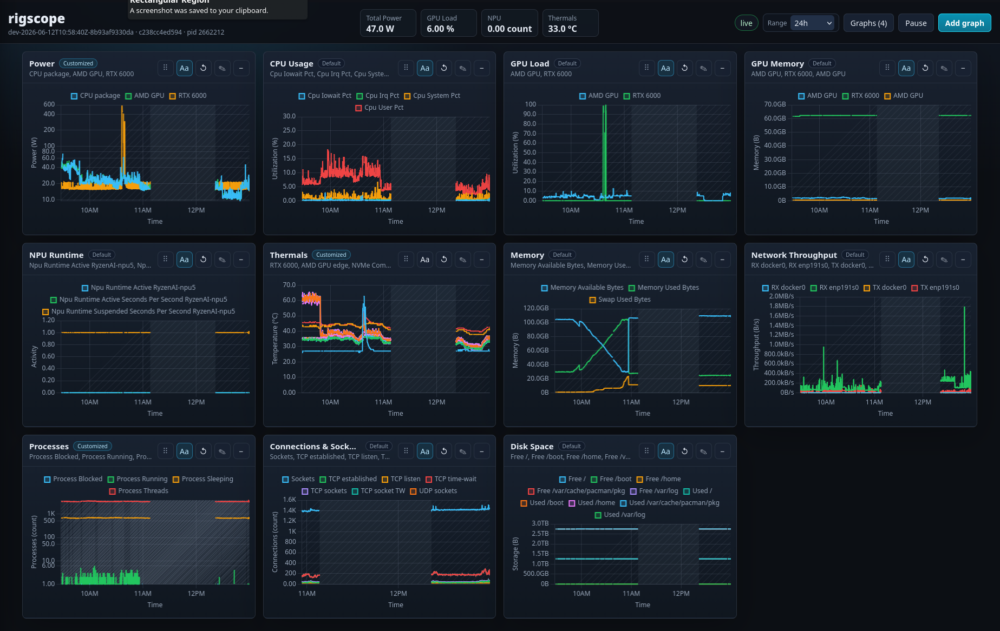

# rigscope

`rigscope` is a continuous hardware telemetry service for power and performance experiments. It autodetects local sensors, stores samples in an embedded time-series database, and serves a browser UI for graphs.



The binary is both the dashboard, daemon, and CLI. Run `rigscope` with no arguments for the live terminal dashboard. It uses a running daemon when one is available and otherwise collects locally with zero configuration. Use `rigscope serve` for continuous collection, persistence, the web UI, and remote clients; commands such as `rigscope status` and `rigscope metrics` query that daemon over HTTP.

The old workload/event runner still exists as a legacy command, but the current direction is an always-on monitor first. Workload events and stdout-fed datapoints are intentionally deferred.

## Quick Start

Download the latest daily build for your platform from the [releases page](https://github.com/lkarlslund/rigscope/releases/latest) and install it as a system service. The binary installs itself: on Linux with `sudo`, on Windows from an elevated (Run as administrator) PowerShell.

```bash
chmod +x rigscope-*-linux-amd64
sudo ./rigscope-*-linux-amd64 service install
```

```powershell
.\rigscope-<tag>-windows-amd64.exe service install
```

Then open:

```text
http://127.0.0.1:7077
```

`install` copies the running binary into place, registers the service to start at boot, and starts it. Re-run `install` with a newer binary to upgrade in place: it replaces the binary, rewrites the service definition, and restarts the service, keeping the data.

```text
rigscope service install [--addr] [--interval 1s] [--retention 0] [--log-level info] [--no-start]
rigscope service start | stop | restart
rigscope service status
rigscope service uninstall [--remove-data]
```

| | Linux | Windows | macOS |
|---|---|---|---|
| Service manager | systemd unit `rigscope.service`, runs as the `rigscope` system user | Service Control Manager, service `rigscope`, delayed automatic start | launchd daemon `com.github.lkarlslund.rigscope` |
| Binary | `/opt/rigscope/rigscope` | `%ProgramFiles%\rigscope\rigscope.exe` | `/usr/local/bin/rigscope` |
| Data | `/opt/rigscope/data` | `%ProgramData%\rigscope\data` | `/Library/Application Support/rigscope/data` |
| Log | journald: `journalctl -u rigscope` | `%ProgramData%\rigscope\logs\rigscope.log` | `/Library/Logs/rigscope/rigscope.log` |
| Default `--addr` | `0.0.0.0:7077` | `127.0.0.1:7077` | `127.0.0.1:7077` |

All three restart the daemon after a crash or error exit. Override the locations with `--binary`, `--data-dir`, and `--log-file`, and pass the same flags to later `service` commands. On Windows, a non-loopback `--addr` also needs the port allowed through the firewall. `uninstall --remove-data` also deletes the data directory, and on Linux the `rigscope` user and group. There is no macOS release build yet; build from source with `go build ./cmd/rigscope`.

Manual source runs are mainly for development:

```bash
go run ./cmd/rigscope
go run ./cmd/rigscope serve
```

The terminal dashboard keeps every graph on one screen; use `Space` to pause and `q` to quit. Summary cards automatically reflow and resize so every detected device remains visible, and their plots expand to consume the available card height. Every terminal receives high-resolution Unicode Braille plots, with a truecolor palette when supported (including Kitty).

Then open:

```text
http://127.0.0.1:7077
```

For development, use the auto-restart runner:

```bash
./rigscope-dev.sh
```

It rebuilds on Go/module/script changes, restarts `rigscope`, and verifies the new process through `/api/build`.

On Windows, use the PowerShell dev runner:

```powershell
.\rigscope-dev.ps1
```

If `go` is not visible in a newly opened shell, make sure `C:\Program Files\Go\bin` is on `PATH`.

Useful flags:

```bash
go run ./cmd/rigscope serve \
  --addr 127.0.0.1:7077 \
  --data-dir data \
  --interval 1s \
  --retention 0 \
  --log-level info
```

Query the daemon from the same binary:

```bash
go run ./cmd/rigscope status
go run ./cmd/rigscope metrics
go run ./cmd/rigscope --server http://127.0.0.1:7077 status
```

Run the test suite:

```bash
go test ./...
```

## Collectors

Collectors self-register and are autodetected by default. Windows supports native system telemetry for CPU, memory, network, disk I/O, filesystems, process counts, and rigscope's own process. Linux additionally supports `/proc`, `/sys`, DRM, XDNA, zenpower, NVML, and ROCm sources where available.

- `cpu`: CPU core count and usage percentages from `/proc/stat` on Linux and native CPU counters on Windows.
- `memory`: memory and swap/pagefile metrics from `/proc/meminfo` on Linux and native memory counters on Windows.
- `network`: per-interface counters from `/proc/net/dev` on Linux and native interface counters on Windows.
- `disk`: block device or physical disk I/O counters.
- `filesystem`: mounted filesystem or Windows drive usage.
- `process`: process state and thread counts.
- `self`: rigscope RSS and open file descriptor or handle counts.
- `nvidia`: Linux NVIDIA power, clocks, utilization, temperature, and memory through NVML.
- `drm`: Linux AMD/Intel DRM sysfs GPU utilization, VRAM/GTT, power, and temperature where exposed.
- `rocm`: Linux fallback AMD GPU/APU power, utilization, temperature, and memory through the ROCm SMI library when DRM/sysfs does not cover the device.
- `zenpower`: Linux CPU package power from hwmon `power1_input`.
- `rapl`: Linux CPU package, core, uncore, and DRAM power from the powercap RAPL energy counters (Intel, and AMD on recent kernels). Skipped when `zenpower` is present.
- `corsair_axi`: Linux Corsair AXi PSU (USB `1b1c:1c11`, e.g. AX1600i) wall input power, voltage and current, total and per-rail output, per-connector 12V power, temperatures, fan speed, and efficiency, read from user space over usbfs. The 12V connectors are read one per sample, so each refreshes every 12 samples.
- `load`: Linux load average from `/proc/loadavg`.
- `socket`: Linux socket and TCP connection counts from `/proc/net`.
- `thermal`: Linux hwmon and thermal-zone temperatures from `/sys`.
- `power_supply`: Linux battery/PSU capacity, power, energy, and temperature from `/sys/class/power_supply`.
- `xdna`: Linux AMD XDNA/Ryzen AI NPU presence, identity, PCI metadata, and runtime-PM residency from `/sys/class/accel`.

The RAPL energy counters and the AXi USB dongle are root-only by default. `rigscope service install` on Linux writes `/etc/udev/rules.d/70-rigscope.rules`, which gives the `rigscope` group access to both. When running as your own user instead, a rule such as `SUBSYSTEM=="usb", ENV{DEVTYPE}=="usb_device", ATTR{idVendor}=="1b1c", ATTR{idProduct}=="1c11", TAG+="uaccess"` grants the logged-in user the PSU.

Metric metadata includes `unit` and `symbol`, such as `watt`/`W`, `celsius`/`°C`, `byte`/`B`, `percent`/`%`, and `count`/`count`.

`xdna` intentionally does not invent a generic NPU utilization percentage. Current Strix Halo kernels expose reliable unprivileged sysfs identity/runtime state, but not a direct NPU busy/power signal. Per-context submission/completion attribution is planned through direct AMDXDNA interfaces where possible.

Disable collectors with:

```bash
go run ./cmd/rigscope serve --no-rocm --no-zenpower
```

## Storage

Samples are stored under `data/tsdb` by default when running manually, or `/opt/rigscope/data/tsdb` when installed with `rigscope service install` on Linux, using `github.com/nakabonne/tstorage`, an embedded Go time-series database. History is unlimited by default; set `--retention` to a duration such as `168h` if you want pruning. The dependency is Apache-2.0 licensed, which is permissive and compatible with an MIT-licensed application; keep its notice/license text when distributing binaries or bundled source.

Current metric examples:

- `gpu_power_w`
- `gpu_power_limit_w`
- `gpu_sm_clock_mhz`
- `gpu_mem_clock_mhz`
- `gpu_temp_c`
- `gpu_util_pct`
- `gpu_mem_used_mib`
- `cpu_package_power_w`

## API

List known series:

```bash
curl http://127.0.0.1:7077/api/metrics
```

Inspect the running build:

```bash
curl http://127.0.0.1:7077/api/build
```

Query one series over the last ten minutes:

```bash
curl 'http://127.0.0.1:7077/api/query?metric=gpu_power_w&collector=nvidia&index=0'
```

Use `start` and `end` query parameters as Unix milliseconds for an explicit time range.

## License

MIT.
